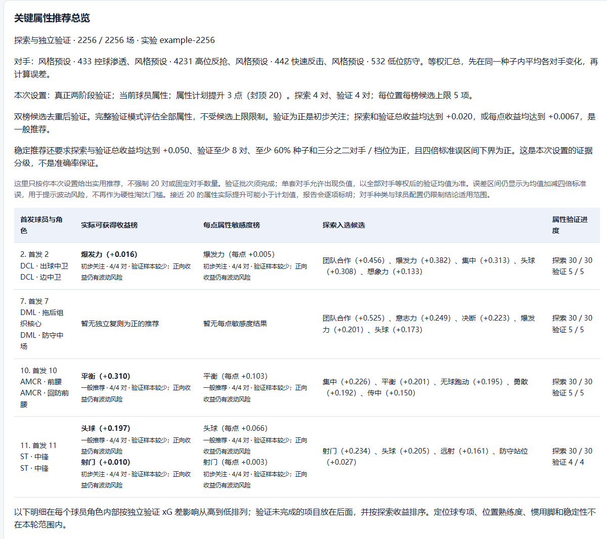
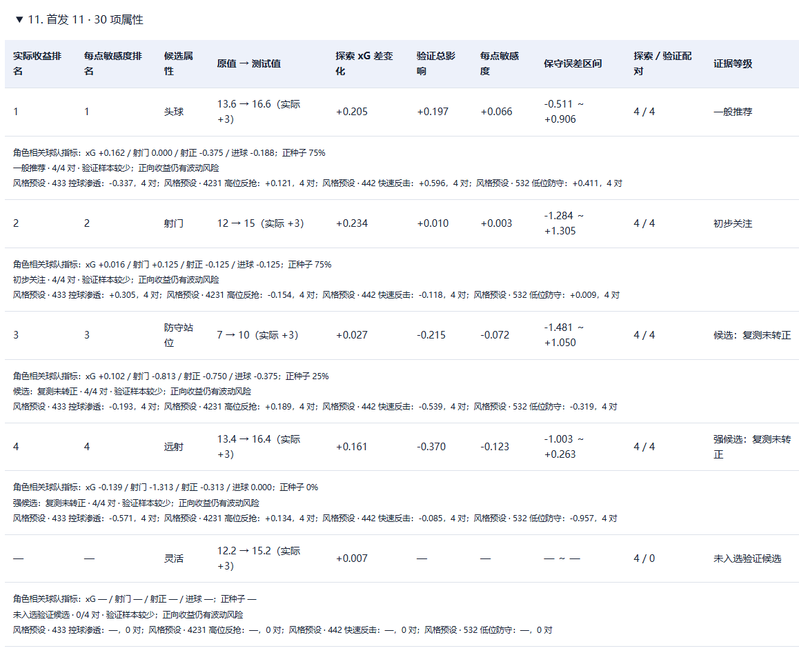

# 战术角色关键属性分析（独立扩展）

本目录提供可选的角色属性实验、推荐报告和运行稳定性修复。PR **只新增本目录**；根 README、上游 `src/`、`native/`、启动器和构建脚本均不直接改写。运行原版程序时不会自动启用本扩展。

扩展构建器先校验基线文件，在本目录忽略的 `build/workspace-*` 中复制上游源码，再应用公开可审阅的接入补丁和新增文件。所有代码接入、编译和打包发生在隔离目录。构建前后均校验原始文件，未知上游改动会明确报错，不静默覆盖。

## 下载后怎么使用

请下载**包含本目录的整个分支 ZIP**或克隆该分支；不要只下载本文件夹。GitHub 页面右上角 `Code → Download ZIP` 可用，解压后从仓库根目录执行下文命令。不要求 ZIP 中包含 `.git`。

上游旧版本发布页的源码压缩包可能不包含本扩展。官方普通 EXE 也不会自动出现属性分析按钮，需要按下文生成扩展版 EXE。

支持基线：`9ba1c1397e6d94fa032a3aedec66baa692f44aad`（v1113.1 / Epic 分离适配）。所有上游输入文件的摘要保存在 `manifest.json`。以后上游更新后，需要重新适配补丁；该校验不承诺任意未来版本兼容。

### 普通构建：不需要 Visual Studio C++

准备 Windows x64、Python 3.11 或更新版本、Git for Windows，以及系统的 .NET Framework C# 编译器。最终使用者运行生成的 EXE **无需另装 Python、Node 或 Git**，但需要本机完整且兼容的 FM27 游戏安装。

1. 从[官方 v1113 发布页](https://github.com/lqf0624/fm-tactics-lab/releases/tag/v1113)下载 `FM27-Tactics-Lab-v1113.exe`。这里固定使用已核验的输入运行时，不接受任意 EXE。
2. 在仓库根目录运行（把输入路径改成自己的）：

```powershell
python extensions/role-attribute-research/build.py --official-exe "下载目录/FM27-Tactics-Lab-v1113.exe"
```

3. 命令最后会打印 `output` 的完整路径。双击该 EXE，选择自己的游戏安装目录，载入战术，在战术板点击“运行角色关键属性分析”。

可以指定新的输出路径：

```powershell
python extensions/role-attribute-research/build.py --official-exe "下载目录/FM27-Tactics-Lab-v1113.exe" --output "输出目录/FM27-Role-Attribute-Research.exe"
```

已有输出文件不会被覆盖。普通构建复用官方原生宿主，包含 Python/UI/启动器改进；下文的完整构建才包含重新编译的 C++ 原子完成标记修复。

### 完整构建：包含当前 C++ 修改

安装 Visual Studio Build Tools 的 C++ x64 工具链及 Windows SDK，在 **x64 Native Tools Command Prompt** 中执行：

```powershell
python extensions/role-attribute-research/build.py --official-exe "下载目录/FM27-Tactics-Lab-v1113.exe" --rebuild-native
```

原生校验资料从已核验的官方包提取，并与公开元数据中的全部区间摘要及其他字段逐项核对；不会跳过游戏兼容性、授权或完赛检查。

### Epic 测试构建

从[官方 Epic 测试版](https://github.com/lqf0624/fm-tactics-lab/releases/tag/v1113-pr13-epic-test)获取对应 EXE，然后运行：

```powershell
python extensions/role-attribute-research/build.py --platform epic --official-exe "下载目录/FM27-Tactics-Lab-v1113-pr13-epic-test.exe"
```

Epic 使用独立启动器、数据目录和适配器。目标为 Epic FM27 27.0.1 的特定 DLL，不能和 Steam 包混用。**Epic 原生比赛尚未实测**；当前只验证了启动、平台拦截和启动器进程树。详见 [Epic 验证范围](overlay/docs/EPIC_ATTRIBUTE_TEST.md)。

## 功能与结果示例

- 勾选一个或多个首发位置；默认属性 +3，可修改，封顶 20。
- 同种子配对、探索与独立验证分离，可测试多套固定对手。
- 总收益与每点敏感度双榜候选、可配置推荐分级、逐属性影响排序。
- 明确区分探索数量与验证数量，导出可离线打开的 HTML 报告。
- 取消续跑、真实完成回执校验和启动器进程树清理。





图片来自一次完成的 2256 场实验，使用当前报告代码重新渲染；球员姓名和实验编号匿名，结果数值保留。每项候选只有 4 个独立验证种子，不能把总比赛数当作单项样本数。历史长批次不冒充新编译宿主的长测。

更多说明：[使用教程](overlay/docs/ROLE_ATTRIBUTE_RESEARCH.md) · [PR 设计、测试和限制](overlay/docs/ROLE_ATTRIBUTE_PR.md)。这些文档中的 `scripts/...` 命令应在生成的隔离工作目录执行，而不是原版仓库根目录。

## 目录与评审方式

| 路径 | 内容 |
| --- | --- |
| `build.py` | 校验、隔离组装、可选验证与打包入口 |
| `manifest.json` | 上游基线、补丁和新增文件摘要 |
| `patches/integration.patch` | 13 个上游文件的最小接入变更，仅在构建副本中应用 |
| `overlay/src/` | 新增分析模块和界面模块 |
| `overlay/scripts/` | 打包和实机验收工具 |
| `overlay/tests/`、`tests/` | 功能测试与扩展构建器测试 |
| `overlay/docs/` | 独立图文说明和验证边界 |

没有注册全局插件，也不修改游戏文件、注册表或根 README。源代码包不包含游戏 DLL、职业生涯存档、原始比赛日志或用户目录。依赖声明与许可证沿用上游；新增代码使用仓库 MIT 许可证。

## 验证

安装 Node.js 后，可只组装和验证源码，不提供官方 EXE：

```powershell
python extensions/role-attribute-research/build.py --prepare-only --verify
```

构建也可附加 `--verify`。该选项运行扩展构建器测试、生成源码的 Python 测试、报告/语言测试及公开源码导出检查；不会自动运行真实比赛。

真正的游戏实测需要在命令打印的隔离工作目录执行：

```powershell
python scripts/acceptance_epic.py --platform steam --exe "生成的EXE完整路径" --game-root "游戏安装目录"
```

已从本分支干净 ZIP（没有 `.git`）完成完整构建：4 项扩展构建器检查通过，183 项功能检查中 179 项通过、4 项跳过，报告和语言检查通过。下载副本生成的 Steam EXE 已完成一场完整比赛、44 场两阶段实验、两个阶段的取消续跑，以及运行中正常/强制退出。详见 [验证记录](VALIDATION.md)。

推荐反映特定球员、战术、对手和属性区间下的实验变化，不是通用属性权重，也不保证复现职业生涯比赛。标准属性档位仍是同一球员，角色专项目前是球队统计。
