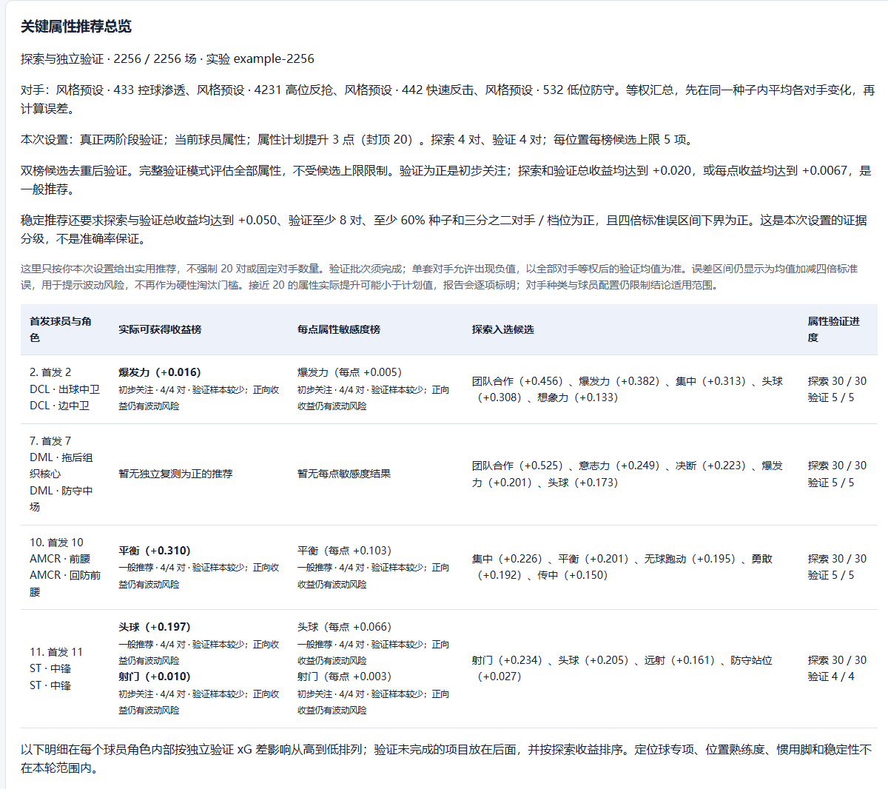
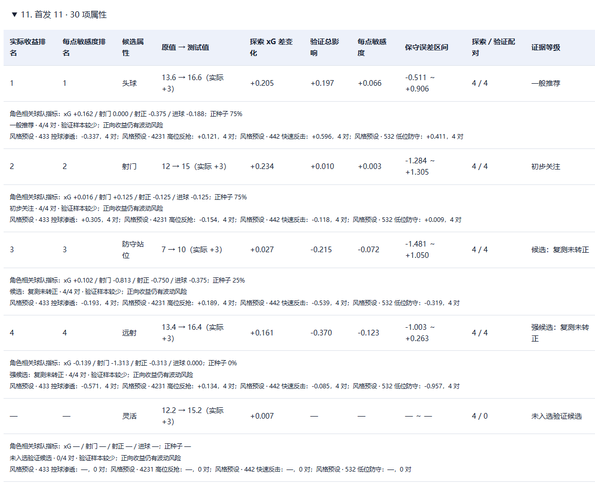

# PR 说明：战术角色关键属性实验与报告

本变更在已有战术板和原生比赛模拟之上，增加“运行角色关键属性分析”入口。用户可以选择多个首发位置，以同种子配对实验比较单项属性提升后的影响，查看独立验证结果并导出离线 HTML 报告。

本说明独立于仓库 README，供维护者评审和用户试用。本文截图来自一次实际完成的 2256 场实验，使用当前报告代码重新渲染；球员名称和实验编号已匿名，收益、误差、场数和结论未修改。截图不是新版本重新模拟出的 2256 场结果。

## 改动解决的问题

- 支持勾选一个或多个首发位置；属性提升默认 3 点、可修改、封顶 20。
- 提供当前球员模式和单属性标准档位模式；外场可探索 30 项、门将 39 项属性。
- 探索与验证使用不重叠的随机种子。多对手先在同一种子内等权平均，再计算均值与标准误。
- 总收益榜与每点敏感度榜分别筛选、合并去重；全部属性完整验证模式不受探索候选上限限制。
- 显示初步关注、一般推荐和稳定推荐，以及配对数量与波动提示。阈值、候选数量和稳定推荐参考配对数均可设置。
- 总览分别显示已完成探索和已完成验证的属性数。完成任务后不再把已验证候选标成“待验证”；无验证数据不显示正式排名或 0% 正向比例。
- 新旧实验的筛选策略有版本区分，旧记录继续使用原规则，避免续跑时改变任务集合。

## 运行结果示例

### 推荐总览



配置为 4 个首发位置、每位置 30 项属性、4 套固定对手、属性提升 3 点；探索与验证各 4 个独立种子。探索完成 120 项，进入验证 19 项。

| 项目 | 本次记录 |
| --- | --- |
| 探索比赛 | `(1 个共享基线 + 120 个属性变体) × 4 对手 × 4 种子 = 1936` 场 |
| 验证比赛 | `(1 个共享基线 + 19 个候选变体) × 4 对手 × 4 种子 = 320` 场 |
| 完成数量 | 2256 / 2256，失败 0，重复 0 |
| 完整性检查 | 2256 条记录均标记通过校验；全部日志哈希一致；重新计算报告与保存报告一致 |
| 推荐结果 | 4 项验证正收益，0 项稳定推荐 |

例如，前腰平衡的验证场均 xG 差改善约为 +0.310，标为一般推荐；中卫爆发力约 +0.016，标为初步关注。后腰没有推荐，是其入选候选的独立验证均值未转正，不是任务失败。

2256 是所有属性、对手和阶段的比赛总数，不是每项属性的独立样本数。本次每项候选仅有 4 个独立验证种子，低于用户设置的稳定推荐参考数 8；正收益项目的四倍标准误区间也均跨零。因此不应把截图当作通用角色属性定论。

### 属性明细与排序



已完成验证的属性按验证收益降序展示，并单列每点敏感度排名。负收益仍保留，未入选验证的属性不编造验证数值。总收益是本次实际提升后的场均 `(xG − xGA)` 改善；每点敏感度是收益除以实际提升点数，只描述本次测试区间，不假定后续提升仍线性有效。

## 稳定性修复

原生宿主先写临时完成标记、刷新并关闭文件，再发布最终标记，以减少读到部分 JSON 的机会。Python 端可重试临时占用和未完成写入，但必须最终读到真实回执；持续损坏、长期占用或非法内容会报错，不再从备用字段生成成功回执。比赛日志的自然终场、比分、统计、输入回读及资源释放校验继续保留。

启动器使用 Windows Job Object 管理后台进程树，正常退出先请求服务关闭，强制结束时清理所属子进程。取消与续跑保留已完成且经过验证的场次，检查引擎、资源和输入指纹，避免混入其他版本的结果。

## 当前源码构建与验证

本次从当前 `native/desktop_host.cpp` 重新编译 Steam 原生宿主，包含原子完成标记修改；不是只替换 Python/UI 后复用旧宿主。比较数据来自 SHA256 已核验的官方发布包，并将全部区间字节、摘要及其他配置与仓库元数据逐项对照，没有放宽本机兼容性检查。

| 验证 | 结果与范围 |
| --- | --- |
| Python 回归 | 183 项，179 项通过、4 项跳过 |
| 报告与界面 | HTML 导出、排序、探索/验证数量、未验证状态及中英文测试通过 |
| 当前源码原生编译 | x64 MSVC 编译通过；声明 `atomic_worker_markers: true` |
| 本机引擎检查 | `compatible: true`，警告 0 |
| 新宿主完整比赛 | 1 场自然完成并通过应用校验 |
| 新宿主两阶段实验 | 44/44 场完成，报告验证通过 |
| 新宿主取消续跑 | 探索完成 2 场时及验证阶段开始后各取消一次；最终已完成场次保留且无重复 |
| 新宿主退出清理 | 批量运行中正常退出和强制结束均清理捕获的相关进程 |
| 历史长批次 | 上述 2256 场来自此前试用包，是功能长批次证据，不冒充新编译宿主长测 |
| Epic | 独立打包、启动与合成进程树测试通过；没有 Epic 游戏安装，原生比赛未实测 |

在 x64 Native Tools Command Prompt 中，从仓库根目录执行以下命令可以复现 Steam 源码构建和验收。官方输入包应是脚本认可的 v1113 EXE；最终程序包含当前源码及重新编译的宿主。

```powershell
python scripts/build_native.py --platform steam --release-exe "官方v1113.exe"
python scripts/repackage_release.py --platform steam --release-exe "官方v1113.exe" --native-host private/engine/fm27_native/FM27Simulator.exe --output "dist/FM27-Tactics-Lab-v1113.1-Role-Attribute-Research-PR-Preview.exe"
python scripts/acceptance_epic.py --platform steam --exe "dist/FM27-Tactics-Lab-v1113.1-Role-Attribute-Research-PR-Preview.exe" --game-root "本机Steam游戏安装目录"
python -m unittest discover -s tests -v
node tests/test_attribute_report.cjs
node tests/test_i18n.cjs
python scripts/export_source.py
```

`acceptance_epic.py` 复用两平台的工作流检查；`--platform steam` 的结果明确记录为 Steam，不能作为 Epic 引擎证据。详见 [Epic 适配范围](EPIC_ATTRIBUTE_TEST.md) 和 [功能使用说明](ROLE_ATTRIBUTE_RESEARCH.md)。

## 评审范围与已知限制

建议评审顺序为：实验构造与统计 → 调度/取消续跑 → 报告与导出 → 原生标记和进程清理 → 构建及测试。源码中不包含游戏 DLL、存档、原始比赛日志、浏览器资料或开发机私有路径。两个新增截图列入源码导出白名单；README 没有功能性改写。

- 这些是条件化的战术实验结果，不是游戏内职业生涯比赛的完整复现，不提供“准确率”保证。
- 稳定等级是可配置的实用证据分级，不是严格置信水平；同时筛选多个属性仍可能偶然出现领先者。
- 标准档位仍使用同一球员的其他属性，并非多个完整代表球员；角色专项展示目前是球队统计。
- 新编译原生宿主已完成短批次、两阶段和取消退出验收，尚未重新完成数千场长测。
- Epic 的固定构建、授权初始化及真实比赛必须等待对应游戏环境验证。

本地构建和测试完成不等于已经发布。此说明用于 PR 评审，提交或合并由仓库维护者决定。
